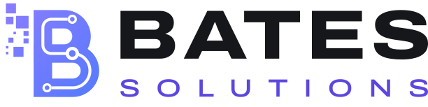

<!--
Bates Solutions README template.

Two designs share one structure:
- Bates design: every repo except a branded product. A Bates banner at the top, the Bates
  wordmark footer.
- Product design (zeepler-web-starter today): the product's own banner and a call to action at
  the top. Bates Solutions is only the last footer line, "<product> is a Bates Solutions product."

Rules
- Keep the sections below in this order, with these exact headings. Leave out a section that
  doesn't apply; never rename or reorder one you keep. Free-form ### subsections are fine inside
  any section.
- Plain language, second person ("you"), present tense. No em or en dashes. Describe only what
  the code does today; put anything unbuilt under Limitations, marked "not built yet".
- Banner: 1280 x 320 SVG, light and dark, at .github/assets/readme-banner-{light,dark}.svg. Text
  is drawn as paths from the brand's own fonts and the logo is the brand's own SVG; never
  hand-drawn. They're generated in the brand library (Bates-Solutions/bates-solutions,
  libs/brand/readme/<repo>/, `npx nx run brand:readme-banners`); add a new repo there and copy
  its folder into .github/assets/. Use the banner's title as its alt text.
- Badge row: shields.io, default flat style, always in this order, each one only if it is real:
    1. CI       a workflow that exists on main
    2. Version  JSR, or GitHub release, or Chrome Web Store once the listing is live
    3. License
- Links to bates-solutions.com and product sites carry
  ?utm_source=github&utm_medium=readme&utm_campaign=<repo name>.
- Delete this comment, the design you aren't using, and every {placeholder}.
-->

<!-- ===== Header: Bates design ===== -->
<a href="https://bates-solutions.com/?utm_source=github&utm_medium=readme&utm_campaign={REPO}">
  <picture>
    <source media="(prefers-color-scheme: dark)" srcset=".github/assets/readme-banner-dark.svg">
    
  </picture>
</a>

<!-- ===== Header: product design ===== -->
<a href="{PRODUCT_URL}?utm_source=github&utm_medium=readme&utm_campaign={REPO}">
  <picture>
    <source media="(prefers-color-scheme: dark)" srcset=".github/assets/readme-banner-dark.svg">
    
  </picture>
</a>

# {Project name}

{One-line tagline: what it is, in one sentence.}

<!-- Product design only: the call to action, right under the badges. -->
<a href="{PRODUCT_SIGNUP_URL}?utm_source=github&utm_medium=readme&utm_campaign={REPO}">
  <picture>
    <source media="(prefers-color-scheme: dark)" srcset=".github/assets/readme-cta-dark.svg">
    
  </picture>
</a>

{Screenshot or GIF, if the repo has one: }

{One or two short paragraphs: what it does and who it's for. An optional status note goes here as
a > **Status:** quote.}

## Features

## Install

## Quick start

## Usage

## Configuration

## Documentation

## How it works

## Limitations

## Privacy

<!-- Required for browser extensions: what is stored, where, and what leaves the browser. -->

## Development

<!-- The commands to build, lint, typecheck and test. CI and release process as ### subsections. -->

## Security

{Optional repo-specific notes first.}

Please report a vulnerability privately, as described in [SECURITY.md]({SECURITY_LINK}). Don't
open a public issue for it.

## Contributing

Contributions are welcome. See [CONTRIBUTING.md]({CONTRIBUTING_LINK}) and the
[code of conduct]({COC_LINK}).

## License

[MIT](LICENSE). {Optional: the trademark note for repos that ship logos.}

<!-- ===== Footer: Bates design ===== -->

---

<a href="https://bates-solutions.com/?utm_source=github&utm_medium=readme&utm_campaign={REPO}">
  <picture>
    <source media="(prefers-color-scheme: dark)" srcset="https://raw.githubusercontent.com/Bates-Solutions/.github/main/brand/bates-solutions-on-dark.svg">
    
  </picture>
</a>

Made by [Bates Solutions](https://bates-solutions.com/?utm_source=github&utm_medium=readme&utm_campaign={REPO}).

<!-- ===== Footer: product design ===== -->

---

[{product}.com]({PRODUCT_URL}?utm_source=github&utm_medium=readme&utm_campaign={REPO}) ·
[Documentation]({PRODUCT_DOCS_URL}?utm_source=github&utm_medium=readme&utm_campaign={REPO})

{product} is a [Bates Solutions](https://bates-solutions.com/?utm_source=github&utm_medium=readme&utm_campaign={REPO}) product.
